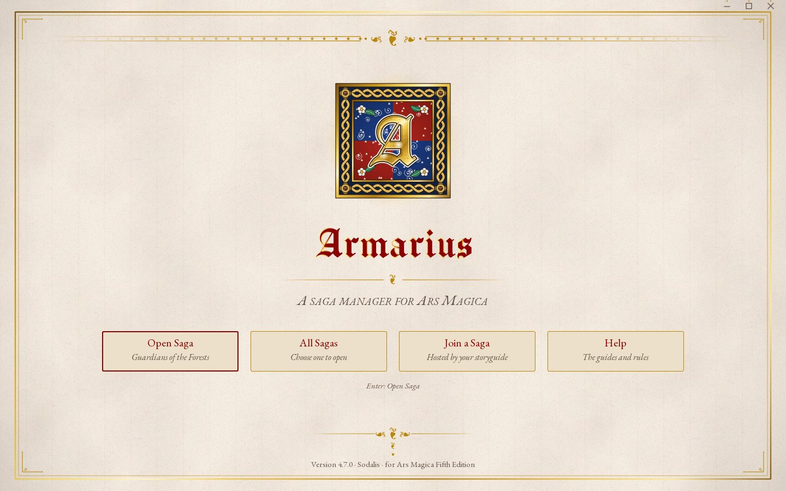
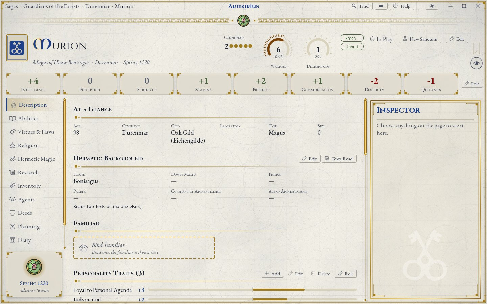
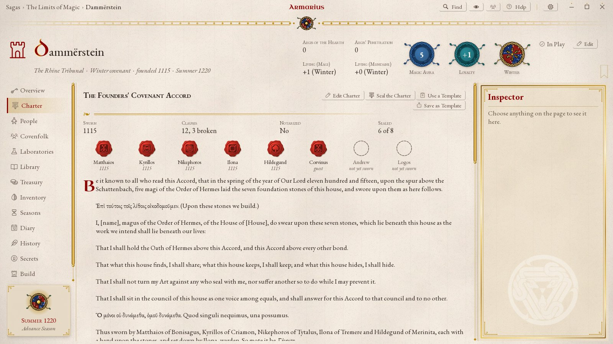
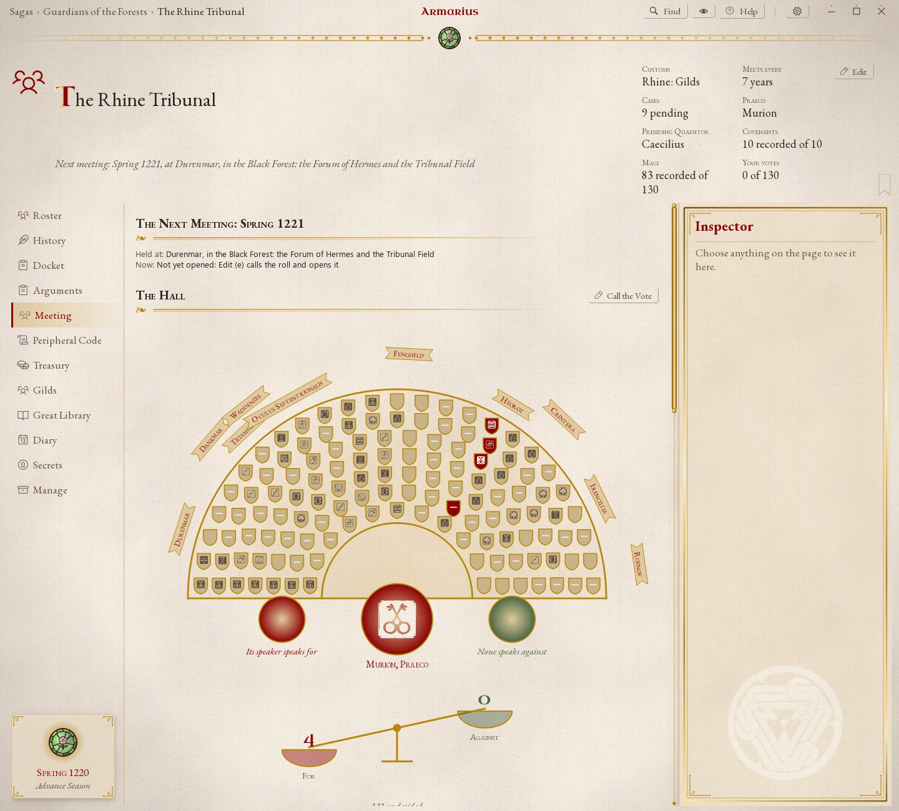
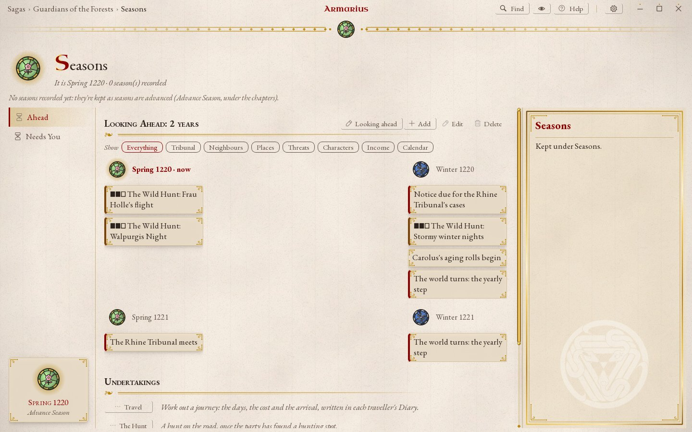
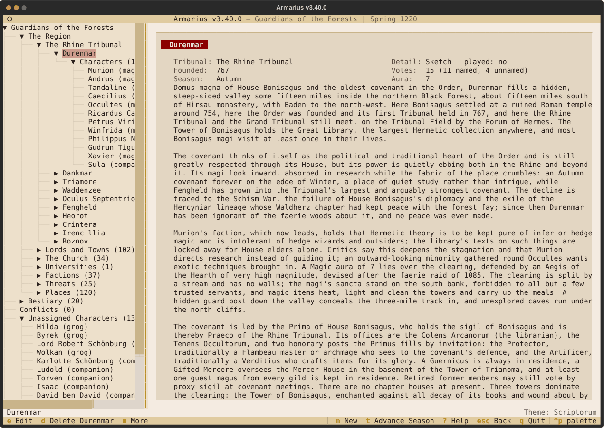

# Armarius

*A saga manager for Ars Magica.*

Armarius (named for the monastery officer who kept the books and records)
is a storyguide's tool for running an **Ars Magica 5th Edition** saga: its
characters, covenants, laboratories and libraries, the world around them,
and the seasons as they pass. It works out the book's arithmetic for you
and keeps a record of what happened.



## What it does

Each part of the app has a name; [CHANGELOG.md](CHANGELOG.md) lists what
each version added to it (the current version is in the title bar).

| Feature | What it is |
| --- | --- |
| **Pagina** | Sheets for characters, covenants, laboratories and familiars, kept in full |
| **Computus** | The rules engine: scores from experience, Lab, Casting and Study totals, Penetration, combat, aging and Warping |
| **Book of Hours** | Seasons planned a year ahead and played out: study, teaching, lab work, books, enchanting, gifts, and each winter's aging and upkeep |
| **Florilegium** | The catalogs of Virtues, Flaws, spells and more, checked against the books, and what a saga offers from them |
| **Gauntlet** | Covenants, laboratories and characters built by the book, step by step, from templates if you like |
| **Orbis** | The saga's world: its Region, people, places, threats and what lies ahead |
| **Concilium** | Tribunals, their customs and their meetings, held step by step |
| **Insignia** | Coats of arms for covenants, lords, towns and factions |
| **Hedge Magic** | The non-Hermetic traditions: their Arts, chapters and rules |
| **Mappa Mundi** | The Atlas: the saga's maps and the records pinned on them |
| **Peregrinatio** | Sourcebooks ready to import as a new saga (below) |
| **Sodales** | Sharing a saga with the troupe (below) |
| **Illuminatio** | The desktop version, drawn as a manuscript, and printing sheets to PDF |
| **Liveries of the Houses** | The desktop drawn in a House's own look: its colours, paper and mark |
| **Scriptorum** | The terminal version: one key per verb, readable at any size |
| **Glossa** | Help for whatever has focus (F1 or `?`), with how-to guides |

**Peregrinatio's packs** are summaries, in the app's own words, of the
sourcebooks' open content, with their covenants, magi, places, creatures
and stories: the Rhine, Normandy, Provence, Theban, Transylvanian,
Hibernian, Levant, Greater Alps, Stonehenge and Novgorod Tribunals; *The
Cradle and the Crescent*, *Lands of the Nile*, *Between Sand and Sea* and
*Land of Fire & Ice* with *The Icelandic Wars*; and *Through the Aegis*,
*Magi of Hermes*, *Legends of Hermes* and *Antagonists*. Each pack has a
Help page saying what it assumed where its book is silent.

**Sodales** shares a saga two ways: players join from their own copy of
Armarius over the internet (Remote seats), or you host the saga on a
private network for their browsers or SSH. Each player changes only what
is theirs, and can make their own character.

There are two front-ends over one shared core: a desktop version (PySide6)
and a terminal version (Textual) that can do the same things.

## A look inside

From a saga started from the Rhine Tribunal pack, and one Charter from a
saga in play.



*Murion of Durenmar's sheet, drawn in House Bonisagus's livery.*



*Dammërstein's Founders' Covenant Accord: who has sealed it, its oath, and its clauses, three of them broken.*



*The Rhine Tribunal's hall: each covenant's seats, and the vote's scales.*



*Seasons: what lies ahead for the saga.*



*Durenmar in the terminal version.*

## Getting started

Requires Python 3.14+ and [`uv`](https://docs.astral.sh/uv/). Armarius is
tested on Windows and Linux, and should run on macOS.

```bash
uv sync
uv run python gui.py       # the desktop version (or run-gui.bat on Windows)
uv run python main.py      # the terminal version
```

Start with **New Saga**, either empty or from a pack, and the Help's
how-to guides walk through the rest. Hosting a saga for players is in
Help's guide to sharing.

Your sagas, backups, exports and settings live in your **save folder**,
by default `Armarius` at the top of your OneDrive (or your app data folder
without one). The saga picker shows where it is, and More (`m`) there has
**Change save folder**. The `ARMARIUS_DATA` environment variable
overrides it.

## Status

Armarius is a personal project. Bug reports are welcome as issues; pull
requests are open to invited collaborators only. To report a security problem, see
[SECURITY.md](SECURITY.md).

## Developing

```bash
uv run python tools/story_check.py          # the tests for what changed, ruff and pyright
uv run python tools/story_check.py --full   # the whole suite, in parallel
```

The core (`ars_magica_manager/`) holds the models, rules, storage, sheets'
text and forms, and never imports a UI library; `ars_magica_manager/tui/`
and `ars_magica_manager/gui/` draw them. [CONTRIBUTING.md](CONTRIBUTING.md)
has the working rules, [DESIGN.md](DESIGN.md) the architecture and
[docs/adr/](docs/adr/) the reasons for each lasting decision.

Work happens on the `dev` branch, and pull requests go into it; `main`
is always the latest release, each one listed on the repository's
Releases page with its notes from [CHANGELOG.md](CHANGELOG.md).

## Licence and credits

Armarius is free software under the GNU General Public License v3.0 (see
[LICENSE](LICENSE)). The Ars Magica rules text in its catalogs, packs and
code is adapted from material licensed under
[CC BY-SA 4.0](https://creativecommons.org/licenses/by-sa/4.0/):

> Based on the material for Ars Magica, ©1993–2024, licensed by Trident,
> Inc. d/b/a Atlas Games®, under Creative Commons Attribution-ShareAlike 4.0
> International license 4.0 ("CC-BY-SA 4.0").

This is an unofficial fan project, not endorsed by Atlas Games or Paradox
Interactive. See [NOTICE.md](NOTICE.md) for sources, changes made, the
artwork, icons, sounds and fonts, and trademark notices.
