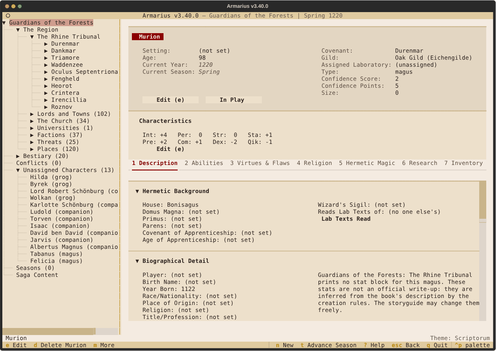
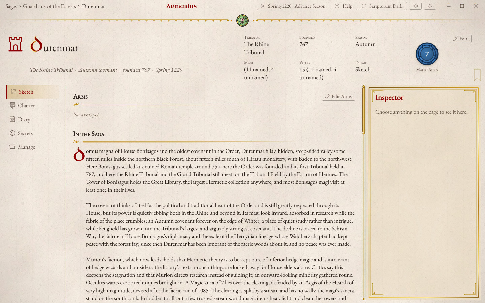

# Armarius

*A saga manager for Ars Magica.*

Armarius (named for the monastery officer who kept the books and records)
is a storyguide's tool for running an **Ars Magica 5th Edition** saga: its
characters, covenants, laboratories and libraries, the world around them,
and the seasons as they pass. It works out the book's arithmetic for you
and keeps a record of what happened. See [DESIGN.md](DESIGN.md) for the
design and roadmap, and [CHANGELOG.md](CHANGELOG.md) for what changed in
each version (the current one is in the title bar).

## What it does

- **Sheets** for characters, covenants, laboratories and familiars, kept
  in full, with the rules worked out: scores from experience, Lab,
  Casting and Study totals, Penetration, combat, aging and Warping.
- **Seasons**, planned a year ahead and played out: study, teaching, lab
  work, books, enchanting, gifts, and each winter's aging and upkeep.
- **Creation by the book**: worksheets that build covenants, labs and
  characters step by step, from templates if you like.
- **The Saga World**: the Region and its neighbours, threats, places,
  regiones and what lies ahead; Tribunals with their customs and
  meetings; heraldry; and the non-Hermetic traditions.
- **Tribunal packs**: eleven sourcebooks ready to import, the Tribunal
  books from the Rhine to the Levant plus The Cradle and the Crescent,
  with their covenants, magi, places, creatures and stories.
- **Sharing**: host a saga so players use it from a browser or over SSH,
  each changing only what is theirs.
- **Help** for whatever has focus (F1 or `?`), with how-to guides.

There are two front-ends over one shared core: a terminal version
(Textual) and a desktop version (PySide6) that can do everything the
terminal can.

| | Desktop | Terminal |
| --- | --- | --- |
| Character |  |  |
| Covenant |  |  |

*Murion and Durenmar, from the Rhine Tribunal pack.*

## Getting started

Requires Python 3.14+ and [`uv`](https://docs.astral.sh/uv/).

```bash
uv sync
uv run python main.py      # the terminal version
uv run python gui.py       # the desktop version (or run-gui.bat)
uv run python tools/serve.py --ssh-port 2222   # host a saga for players
```

Your sagas, backups, exports and settings live in your **save folder**,
by default `Armarius` at the top of your OneDrive (or your app data folder
without one). The saga picker shows where it is, and More (`m`) there has
**Change save folder**. The `ARMARIUS_DATA` environment variable
overrides it.

## Developing

```bash
uv run pytest -q -n auto --dist worksteal   # the full suite
uv run python tools/slice_tests.py          # the fast tier plus affected screen tests
uv run ruff format . && uv run ruff check .
uv run pyright                              # must report 0 errors
```

The core (`ars_magica_manager/`) holds the models, rules, storage, sheets'
text and forms, and never imports a UI library; `ars_magica_manager/tui/`
and `ars_magica_manager/gui/` draw them. [CLAUDE.md](CLAUDE.md) has the
working rules and DESIGN.md the architecture.

## Licence and credits

Armarius is free software under the GNU General Public License v3.0 (see
[LICENSE](LICENSE)). The Ars Magica rules text in its catalogs (`data/`)
and code is adapted from material licensed under
[CC BY-SA 4.0](https://creativecommons.org/licenses/by-sa/4.0/):

> Based on the material for Ars Magica, ©1993–2024, licensed by Trident,
> Inc. d/b/a Atlas Games®, under Creative Commons Attribution-ShareAlike 4.0
> International license 4.0 ("CC-BY-SA 4.0").

This is an unofficial fan project, not endorsed by Atlas Games or Paradox
Interactive. See [NOTICE.md](NOTICE.md) for sources, changes made and
trademark notices.
