# Threat model: Hosting for browsers and SSH

Status: written 2026-11-10 against 4.6.2 (the 4.4.0 security review's fixes 1, 4, 5 and 7, STORY-2258); updated 2026-11-11 for STORY-2260, which built mitigations M1, M2, M4, M5, M6 and M9 of section 7 (findings 2 and 3) and a guard against pickle (finding 6). M3, M7 and M8 remain proposals. Its companion, for players with their own Armarius, is [Threat model: Remote seats](threat-model-remote-seats.md). Code: `hosting.py` (the core's `HOST` and `Plan`), `tui/serve.py` (the server process), `tui/hosting.py` (each player's copy, and the SSH server), `players.py` (sign-in), `seat.py` and `viewing.py` (what a signed-in copy may do). Terms: see GLOSSARY.md (Host for Players, Player, Storyguide).

This path is the older and simpler of the two ways to play from afar. The storyguide's computer runs a small web server (textual-serve) and, if asked, an SSH server. Every browser tab or SSH session that reaches it gets its own copy of the terminal app, a separate process on the storyguide's computer, reading and writing the storyguide's own data folder. The transport proves nothing about who is there: identity is the app's own sign-in, a player's name and passcode. The whole design leans on one assumption, that only the troupe can reach the address, because it is on a private network (Tailscale, ZeroTier, a home network). Most of what follows is what happens when that assumption fails, and what still holds when it does.

## 1. What we protect

Ranked by what a leak or a change would cost. The list is the Remote seats one, since the assets are the same; what differs is how close an outsider gets to them.

1. The saga's Secrets, and records the players don't yet know.
2. The integrity of the saga: no unauthorised edits, no lost data.
3. The storyguide's PC and the rest of their files. Here this ranks higher in practice than for Remote seats: every connection runs a full copy of the app, as the storyguide's own user account, on the storyguide's PC.
4. Each player's passcode.
5. Availability on game night.
6. Players' addresses and when they play (low here: everyone on a private network already sees each other's addresses).

## 2. Who we defend against

| | Actor | Note |
|---|---|---|
| A | A bad player who holds a real name and passcode | Signs in normally, then tries for more than their rights |
| B | Someone else on the same network: a stranger on café or hotel Wi-Fi, another device on the home network, another member of a shared Tailscale or ZeroTier network, or anyone at all if the host listens on a public address | Reaches the web page and the SSH port with no credential; gets an app copy and a sign-in dialog |
| C | A hostile web page open in the browser of anyone who can reach the host (the storyguide included) | The browser lets any page open a WebSocket to the host's address; the page then drives an app copy as actor B would |
| D | A network eavesdropper or modifier on the path between player and host | Matters only where the private network doesn't encrypt (a home or public Wi-Fi network) |
| E | A signed-in Storyguide-role player | Trusted with the whole saga by design; the question is whether they also get the host's PC |
| F | A player's own compromised computer | Not defended from inside the app, as for Remote seats |

Unlike Remote seats, there is no "malicious host" actor here: the player's side is a browser or an SSH client that only draws what the host sends, so a fake host can show the player wrong pages and collect a passcode typed into them, but reaches nothing else of theirs.

## 3. Parties and trust boundaries

```mermaid
flowchart LR
    subgraph P["Player's computer"]
        PB["Browser (textual-serve page)"]
        PS["SSH client"]
    end

    subgraph N["Private network (Tailscale, ZeroTier, home Wi-Fi)"]
        NW["Plain HTTP and WebSocket; SSH"]
    end

    subgraph H["Storyguide's computer"]
        WS["textual-serve: /, /ws, /download, /static"]
        SS["asyncssh server: no SSH login"]
        C1["One app copy per tab or session (own process, storyguide's account)"]
        SI["Sign-in dialog (players.sign_in)"]
        CO["Core: seat.py, viewing.py, players.guard_changes, storage merge"]
        D[("Data folder: sagas, settings, exports")]
        KC[("OS keychain: SSH host key")]
        O["Rest of the PC"]
        WS --> C1
        SS --> C1
        SS --- KC
        C1 --> SI --> CO --> D
    end

    PB -- "B1: plain HTTP, WebSocket" --> NW
    PS -- "B1: SSH (encrypted, host key pinned by the client)" --> NW
    NW -- "B2: reaches the listening address" --> WS
    NW -- "B2" --> SS
    C1 -. "B3: keys and mouse become actions" .-> SI
    CO -. "B4: what a copy may touch" .-> D
    C1 -. "B4" .-> O
```

Boundaries:

1. **B1**: the player's browser or SSH client to the network. The browser path is plain HTTP; its only protection in transit is whatever the private network adds (Tailscale and ZeroTier encrypt between devices; a home or public Wi-Fi network shares it with everyone who holds the Wi-Fi key). The SSH path is encrypted by SSH itself.
2. **B2**: the network to the host's listener. The listener answers whoever reaches the address and port; there is no transport login. This is the boundary finding 2 of the 4.4.0 review is about.
3. **B3**: a connection to the app copy's sign-in. Before sign-in a copy shows the saga list, Help and the sign-in dialog; after it, everything the seat allows.
4. **B4**: the app copy to the host's files and PC. Each copy is the full application, running as the storyguide, so what a copy may touch is decided only by the app's own rules (`seat.may_act`, `viewing.PLAYER_BARRED_ACTIONS`), not by the operating system.

## 4. How it is built, and decisions already made

- The host listens on one address the storyguide chooses, `localhost` unless told otherwise, and the default is this computer's Tailscale address if it has one (`hosting.last_plan`). The Host for Players form labels each address: Tailscale, "a private network", or "reachable from the internet: don't" (`hosting.address_label`). An address the internet routes to, or every address (`0.0.0.0`, `::`), is refused (`hosting.is_public`, checked in `Host.start` and again by the server process itself) unless the storyguide ticks "I know this is reachable from the internet" (`tools/serve.py`: `--allow-public`). The tick is never remembered. A typed name is looked up when hosting starts.
- The web host answers a request only if its `Host` header names the listening address (with loopback's other names for `localhost`), and opens an app copy on `/ws` only if the `Origin` is the host's own page (`hosting.request_allowed`, an aiohttp middleware in `tui/hosting.addressed_to`). A request to another name, or a WebSocket from another site's page, gets 403.
- There is no login at the transport. The web page has no password and sets no cookie; the SSH server's `begin_auth` returns False, so any user name gets in with no key and no password. Who the player is comes only from the in-app sign-in, the same for both ways in. Because nothing is remembered between connections, a signed-in tab carries no credential a second tab could reuse: every connection starts unsigned.
- Each connection is its own process, started by textual-serve's `AppService` (adapted in `tui/hosting.HostedAppService`), running `main.py` with `ARMARIUS_TRANSPORT` set to `web` or `ssh`. A copy with that variable never hosts (`hosting.is_hosted_copy`), never shows the data folder's path, and doesn't offer New Saga, Delete Saga, the save folder or the title page.
- A hosted copy opens a saga only after the sign-in dialog accepts a name and passcode (`saga_picker.open_saga`, through `hosted_signin.attempt`); a saga with no Players can't be opened from a browser at all. The dialog's refusal is one sentence whatever was wrong. Passcodes are checked against the saga's scrypt hashes (n = 2^14, r = 8, p = 1, 16-byte salt), in constant time.
- Wrong passcodes wait by the same rule as Remote seats (`lockout.py`: three free, then 30 s, 2 min, 10 min, then an hour each). The count is kept per name typed, in a file in the host's data folder outside the saga (`remote/<saga>-signin.json`), shared by every copy under a lock, so a new tab doesn't start afresh. A name no player has is counted the same way. A right passcode clears the count.
- The 14-character minimum (`players.MIN_PASSCODE`) applies when a passcode is set, and now at this sign-in too: a shorter passcode signs in once more and the player is asked to choose a new one; they may put it off that once, after which it is refused until changed (here, or by the storyguide). Which short passcode had its last sign-in is noted by its salt, so any new passcode starts afresh. A new passcode chosen here is saved as the player (`storage.Saver`) and noted as long enough for Remote seats.
- Once signed in, a Player-role copy may read what `viewing.py` lets that player read and change what `players.may_change` lets them change; `storage.guard` (set by `seat.sign_in`) takes back anything else as the save is written. The barred list (`viewing.PLAYER_BARRED_ACTIONS`) includes everything that reads the host's disk (Import, Update from a File) or writes the whole saga out (Export Saga, Export Pack, Export a Cult). Unlike a Remote seat, the copy holds the whole saga in its memory: hiding is done as each page is drawn, not by leaving data out. That is safe while the only way to reach the copy's memory is through what it draws, which is true of a browser tab and an SSH terminal (neither can run code in the copy).
- A Player's Export of one record downloads to their browser, filtered for them (`transfer.for_reader`). Over SSH, Export isn't offered, since the file could only land on the host.
- A Storyguide-role sign-in runs the saga (`seat.runs_the_saga`): it may do everything the host's own window may, except host. That includes Import, whose file chooser (`forms/importing.py`, `ChooseFile`) in a hosted copy shows only the exports folder and below (`hosting.ConfinedFolder`: Up stops there, a typed path outside is refused, links are followed before the check, and paths are shown as `exports/...`, never as the host's own), and Save an example CSV, which writes into the exports folder. A Storyguide-role password is therefore the saga and the exports folder, not the PC's other folders.
- A hosted copy has no command palette (Ctrl+P), and never writes the host's `settings.json` (`ArsMagicaManagerApp.watch_theme`).
- Every copy shares the data folder. A save is merged with the others' (ADR 0005), and each copy rereads the saga every few seconds.
- The SSH host key lives in the OS keychain (`KeychainStore`, entry `ssh-host-key`), never in the synced data folder; a key left there by an older version is moved in and the file deleted; with no keychain, SSH hosting is refused (4.6.2, fix 1). Players' SSH clients pin it the first time they connect.
- The SSH server takes only an interactive shell. asyncssh's defaults refuse port forwarding (TCP and Unix), `exec` and subsystems (so no SFTP or SCP), and the app adds no handlers for them; checked against asyncssh 2.24.1.
- Pictures served to or imported by any copy go through one name check, `picture_files.safe_name`, which refuses folders, drive letters, `:streams`, device names and anything that isn't a picture (4.6.2, fix 4).
- The host process is ended whole, with every player's copy, when the storyguide stops hosting or closes the app (`hosting._end`, `taskkill /T` on Windows). A copy whose tab closes is given two seconds to quit, then killed.

## 5. Threats and controls (STRIDE per boundary)

S spoofing, T tampering, R repudiation, I information disclosure, D denial of service, E elevation of privilege. **Gap** marks a threat with no control today; section 7 proposes one for each.

| Boundary | | Threat | Control |
|---|---|---|---|
| B1 player to network | I | Passcodes and every page read in transit on a network that doesn't encrypt (D) | Tailscale and ZeroTier encrypt between devices. **Gap** on a home or public Wi-Fi network: the browser path is plain HTTP and the passcode crosses it as typed. SSH is encrypted |
| | T | Pages or keystrokes changed in transit (D) | As above: the private network's encryption, or SSH's. **Gap** on plain Wi-Fi |
| | S | A fake host (on a shared network, or a mistyped address) shows a sign-in dialog and collects a passcode (B, D) | SSH: the client's pinned host key warns of a change. **Gap** for browsers: plain HTTP proves nothing about the host |
| B2 network to listener | S | Anyone who reaches the address gets an app copy (B) | Defaults to localhost or the Tailscale address; a public address (or every address) is refused unless the storyguide ticks that they know (M1), in the app and in the server process; Help says never to host on one. Residual: a storyguide who insists, or a private network shared with strangers |
| | S | A hostile web page in a reachable browser opens `/ws` and drives a copy (C) | No cookie or remembered sign-in, so the page gains only what actor B gains; and `Host` must name the listening address and `/ws`'s `Origin` the host's own page (M4), which closes cross-site WebSocket and DNS rebinding |
| | D | Each connection starts a full Python process; many tabs or SSH sessions exhaust memory (B, C) | **Gap**: no cap on copies, and an unsigned copy is never closed for idleness |
| | I | Download links (`/download/{key}`) reachable by key alone (B, D) | Keys are random, made by Textual for each download; a download carries only what that player's Export may hold |
| B3 connection to sign-in | S | Guessing a player's passcode online (B, C) | scrypt per try; uniform refusal; three free tries per name, then growing waits shared by every tab (M2); a passcode under 14 characters signs in once more, then must be changed (M6). Residual: a guesser can make a real player wait (up to an hour at a time) by guessing their name |
| | S | Guessing a Storyguide-role passcode (B, C) | As above; the prize is the whole saga and the exports folder (row E below) |
| | I | Learning the saga names, and which player names exist, before signing in (B) | The picker lists saga names to anyone; the dialog's message is the same for a wrong name and a wrong passcode. A wrong name skips the scrypt, so timing can tell real names apart (minor) |
| | T | An unsigned copy changing shared host state (B, C) | New, Delete and the save folder aren't offered in a hosted copy; the command palette is off there and a hosted copy never writes `settings.json` (M5). The sign-in's own count file is written by unsigned copies, by design (M2) |
| | R | "I never signed in" / "I never changed that" | Saves record who saved (`storage.saved_by`). **Gap**: no log of sign-ins or failures for this path; the Remote seats Log doesn't cover it |
| B3 after sign-in | E | A player asks for more than their rights (A) | `seat.may_act` on every action, `viewing.PLAYER_BARRED_ACTIONS`, `storage.guard` with `players.guard_changes` on every save |
| | I | A player reads what is hidden from them (A) | `viewing.py` decides every page as it is drawn, and tests draw the sheets as a player. The whole saga is in the copy's memory, so a drawing bug is a leak (residual) |
| | I | A player exports more than they may read (A) | `transfer.for_reader`; whole-saga, pack and cult exports barred |
| B4 copy to files and PC | E | A Storyguide-role sign-in browses and reads the host's disk (E, or B with a guessed passcode) | Only Storyguide-role sign-ins are offered Import; it reads only the app's file kinds; in a hosted copy the chooser keeps to the exports folder and names paths from there (M9) |
| | E | A saga, pack or export runs code as it is read | Data comes in as JSON through `shapes.py`; `tests/test_no_pickle.py` fails on any import of pickle, marshal or shelve, or any reading of pickled bytes from a file (finding 6). One module pickles in memory (`seasons/projection.py`, a fast copy of the saga), its bytes never leaving the process |
| | E | Path traversal through a picture name or an imported file's names (A, E) | `picture_files.safe_name` everywhere a picture name comes in (4.6.2); records by id, never client-supplied paths |
| | E | A flaw in Textual, textual-serve or asyncssh input handling runs code in a copy (B) | Copies are separate processes but run as the storyguide's account. No sandbox: residual |
| | T | Two copies saving at once lose a change | Hosted saves merge (ADR 0005) |
| | I | The SSH host key leaks through the synced data folder (review finding 1) | Keychain only, old file moved in and deleted (4.6.2) |
| | E | A player reaches a shell, a forwarded port or files over SSH (A, B) | Only a shell request is accepted, and the shell is the app; forwarding, exec and subsystems refused by asyncssh's defaults |

## 6. The 4.4.0 security review's findings, as they bear on this path

The review (a friend's, of 4.4.0) had seven findings; fixes 1, 4, 5 and 7 were made (STORY-2258, version 4.6.2). Findings 2, 3 and 6 were declined at first, then taken up before the repository went public (STORY-2260): M1, M4, M5 and M9 for finding 2, M2 and M6 for finding 3 (argon2 was not chosen), and `tests/test_no_pickle.py` for finding 6. Three were asked to be carried into this model:

- **Finding 2, plain HTTP and SSH with no transport login (low to medium, by design).** This whole document is the long form of it. The review's point stands: the defence is the address, and the risk appears when the address is public or the network untrusted (a café, a hotel, a shared tailnet). Writing the model turned up three more things the finding didn't name: cross-site WebSocket from a hostile page (actor C), unlimited passcode guesses (B3), and the Storyguide-role file chooser (B4). They raised its weight a little: on a reachable address, one guessed Storyguide passcode read the whole saga and browsed the PC's folders. M1 (the guard), M4, M2 and M9 now answer each of the four.
- **Finding 3, saga files with passcode hashes in OneDrive (low).** On this path the stored hash isn't password-equivalent (that is Remote seats' proof), so a stolen copy of the saga allows only an offline guess per player, at scrypt's cost; the plan to move the data folder off OneDrive removes the cloud copy. The bigger exposure here was online: with no lock-out, a weak passcode fell to guessing at the dialog without the file at all, and pre-14-character passcodes still worked on this path. M2 and M6, cheaper than argon2, close that.
- **Finding 5, invites accept `ws://` (low, fixed in 4.6.2).** It doesn't apply to this path directly: there are no invites here. It is listed because it is the same question asked of the other path, "what if the transport is plain?", and the answers differ: Remote seats run their own TLS 1.3 inside the WebSocket, pinned to the host's key, so a plain outer transport costs only metadata; this path has no inner layer, so a plain network costs everything typed and shown. That is why this path must stay on an encrypting private network, and why M8 (Tailscale's own HTTPS) is worth a line in Help.

## 7. Mitigations

Each names the design pattern it fits, preferring ones the app already uses. **Built** (STORY-2260): M1, M2, M4, M5, M6, M9. **Proposed**: M3, M7, M8.

- **M1. Refuse a public address unless the storyguide insists** (finding 2). **Built.** `Host.start`, before anything listens, refuses a `Plan` whose address `hosting.is_public` (an address the internet routes to, or every address; a name is looked up) unless the form's "I know this is reachable from the internet" box is ticked; the server process refuses it too unless given `--allow-public`, so `tools/serve.py` is covered. *Pattern:* a **Guard Clause**, one check at the top of the existing `Host` Facade, so the desktop and the terminal get it without each screen deciding.
- **M2. Slow and lock out wrong passcodes on this path too** (findings 2 and 3). **Built.** `hosted_signin.SignInBook` keeps a count per name typed in the host's data folder, under a lock (`remote/folder.SharedFile`); the waits are `lockout.py`'s, the same rule `remote/devices.py` now calls. Counting by name, not by player, keeps the waits from telling real names from made-up ones. *Pattern:* one policy both sign-ins call, a **Strategy** for "may this try go ahead?" with the file-backed counter behind it.
- **M3. Cap the copies, and close an unsigned one after ten minutes.** A counter in `HostedAppService.start` refuses a copy past (say) twenty, and a timer ends a copy that hasn't signed in, matching Remote seats' sign-in deadline. *Pattern:* plain functions around the existing `AppService` subclass; in Python an "Object Pool" reduces to a counter.
- **M4. Check `Origin` and `Host` on `/ws`.** **Built** (`hosting.allowed_hosts`, `hosting.request_allowed`, `tui/hosting.addressed_to`). An aiohttp middleware refuses a WebSocket whose `Origin` isn't the page's own address and a request whose `Host` isn't the listening address, which closes actor C's cross-site and DNS-rebinding routes. *Pattern:* aiohttp's middlewares are a **Chain of Responsibility**; this is one more link in front of textual-serve's handlers.
- **M5. Turn off the command palette in a hosted copy, and don't write settings from one.** **Built.** Clear `use_command_palette` when `hosting.is_hosted_copy()`, and have `watch_theme` save only in the storyguide's own window. *Pattern:* a Guard Clause on the existing `is_hosted_copy` flag.
- **M6. Apply the 14-character rule to browser and SSH sign-ins.** **Built** (`hosted_signin.attempt`, `change_passcode`; the dialog in `tui/screens/prompts._new_passcode_dialog`). Accept an older short passcode once more, asking the player to set a new one before the saga opens; Not Now is allowed that once, after which the short passcode is refused until the player or the storyguide sets a new one. *Pattern:* the existing `players.passcode_problem` is already a **Specification** in all but name (one rule answering "is this passcode good enough?"); call it from the sign-in too.
- **M7. Log sign-ins and failures to the same Log.** *Pattern:* reuse `remote/audit.py`; the hosted copies become a second writer of the same append-only log, as the listener is.
- **M8. Recommend HTTPS on the tailnet in Help.** `tailscale serve` can put the host behind `https://YOUR-PC.YOUR-TAILNET.ts.net` inside the tailnet, so a browser checks a certificate and nothing crosses even a home network in plain text. Documentation only.
- **M9. Confine the Storyguide-role file chooser in a hosted copy** to the exports folder (and below). **Built** (`hosting.ConfinedFolder`, `hosting.confined_chooser`, given to the terminal's file list for every `ChooseFile` in a hosted copy; the spell example is saved there too). *Pattern:* a **Proxy** for the file system: a chooser given a root it can't climb out of, so the rule lives in one object rather than in each import.

Of what remains, rough order by value for effort: M3, M7, M8.

## 8. Residual risks we accept and state plainly

- Hosting for browsers and SSH trusts the network. A public address is refused unless the storyguide insists; but on an untrusted private network (a shared tailnet, café Wi-Fi), or a public address insisted on, anyone there gets an app copy and a sign-in dialog, with three free guesses per name and growing waits after; on a network that doesn't encrypt, everything typed and shown, passcodes included, can be read. Help says to host only on Tailscale, ZeroTier or a trusted home network.
- Someone who can reach the host can make a real player wait (up to an hour at a time) by guessing at their name. The price of counting per name.
- Every copy is the whole application running as the storyguide, holding the whole saga in memory; what a player sees is decided as pages are drawn. A drawing bug can show a player something hidden, and a flaw in Textual, textual-serve or asyncssh could reach the storyguide's account. Remote seats remove the first by sending each seat only its own view; nothing here removes the second.
- A Storyguide-role sign-in is trusted with the saga and, through Import, with reading the app's kinds of file in the host's exports folder. Give that role only to someone you would trust with the saga.
- Browsers can't verify the host: a player who types the wrong address on a shared network can be shown a fake sign-in dialog. SSH clients warn when the host key changes; players must not accept that warning without asking.
- A Player's passcode can still be guessed online, slowly: after three tries, a few a day per name. A short pre-14-character passcode stays guessable until its one remaining sign-in is used and it is changed.
- Availability depends on the storyguide's PC being on and awake, and on the private network.
- Players on one private network can see each other's addresses; ZeroTier lets every member reach every other device unless its Flow Rules say otherwise (Help gives the rules).
