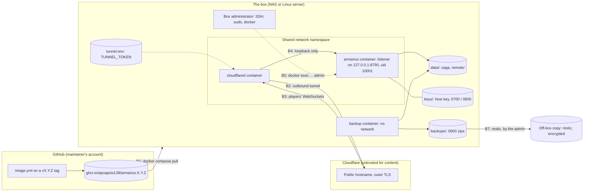

# Threat model: A headless host (Castellum)

Status: draft, 2026-11-15, not yet reviewed. Covers what FEAT-23 (Castellum, 4.13.0) added: the public container image, the compose file, the Cloudflare Tunnel beside it, the file key store, the `admin` word and the host's backups (STORY-2282 to STORY-2286). Design: [ADR 0022](adr/0022-a-headless-host-keeps-its-key-in-a-file.md). Terms: see GLOSSARY.md (Remote seat, Invite, Device credential).

The listener on the box is the same listener a desktop runs, so everything in [the Remote seats threat model](threat-model-remote-seats.md) still holds: the inner TLS session pinned by the Invite, Invites and approvals, passcode proofs, `seat_view`, `players.guard_changes`, the audit log. This document models only what changes when the host is a container on a box nobody sits at: the key becomes a file, the code arrives as a published image, the host is looked after from a shell, and the saga is copied every night.

Out of scope, as in SECURITY.md: an attacker who already controls the box's root account or the maintainer's GitHub account. Both are named below where they matter, once, rather than modelled per threat.

## 1. What we protect

Ranked by what a leak or a change would cost.

1. The host key (`/keys`). Whoever holds it can be the host to every player: their pins accept it, so they would send passcode proofs, changes and, to a Storyguide-role seat, read the whole saga from it.
2. The saga's Secrets and the records players don't yet know, in `/data/sagas` and in every backup zip.
3. The passcode digests in the saga file (password-equivalent for the sign-in proof) and the Remote seat files (`/data/remote`: Invites, devices, passcodes noted, Log, tunnel plan).
4. The Cloudflare Tunnel token (`tunnel.env`). Whoever holds it serves the saga's public address.
5. The integrity of the saga, and that a restore gives back what was saved.
6. The rest of the box (a NAS holds a household's files).
7. Availability: the box keeps hosting while nobody watches it.

## 2. Who we defend against

Actors A to F of the Remote seats model still apply at the listener. These are added.

| | Actor | What they can already do, with no exploit |
|---|---|---|
| G | An administrator of the box: a NAS admin account, a sudoer, any member of the `docker` group | Read every folder, `docker exec` into the container, `docker inspect` its environment, mount `/keys` into a container of their own. Equivalent to root on the box; out of scope, but named so nobody mistakes the key's file modes for protection from them |
| H | Someone who takes the box's disks: a burglar, a drive sent back for repair, a disk sold on | Read every unencrypted file at rest |
| I | Someone who gets a backup zip: a copy on another computer, a cloud folder, a NAS snapshot copied off | Read whatever the zip holds |
| J | Whoever controls what the box pulls: the image registry (ghcr.io), the base images (Docker Hub's `python`, `cloudflare/cloudflared`, `ghcr.io/astral-sh/uv`), PyPI, GitHub Actions | Change the code the listener runs, if a control below fails |
| K | A flaw in the listener, exploited by actor B (an outsider who finds the address) | Run code as uid 10001 inside the container |
| L | Cloudflare, as the tunnel provider and DNS host | See metadata; route or drop the address; never read content (inner TLS, Remote seats model section 4) |

## 3. Parties and trust boundaries

Boundaries:

1. **B1**: the registry to the box. The code the listener runs comes from outside.
2. **B2**: cloudflared to Cloudflare. Outbound only; the token authenticates the box to Cloudflare.
3. **B3**: players to Cloudflare to cloudflared. Remote seats model boundaries B1 and B2, unchanged: the inner TLS session passes through.
4. **B4**: cloudflared to the listener, over the container's loopback. Nothing else on the box or the LAN reaches the listener.
5. **B5**: the box's administrator to the app, through `docker exec ... admin`. No authentication of its own: the operating system's is the only one.
6. **B6**: the container to the box's disks: the three volumes, and the key store's refusal rules at their edge.
7. **B7**: backups leaving the container, and leaving the box.

## 4. Decisions made while modelling

Each is checked in the code unless it says otherwise.

- **The key is a file only when asked.** `ARMARIUS_KEYSTORE=file` picks `FileKeyStore`; empty or `keychain` picks the keychain; any other value gives `RefusedStore`, which refuses every use and says why, never quietly falling back to the keychain (`remote/key_files.py:189-205`; `test_an_unknown_store_setting_is_refused_not_ignored`). The image sets `file` and `/keys` (`deploy/Dockerfile:51-52`).
- **The key folder is checked before every use, and refused rather than repaired** (`key_files.py:136-142`), in this order: not root (`:108-118`), apart from the data folder in both directions, resolved so a link can't hide it (`:78-86`), present (`:121-134`), owned by the app's user with no group or other bits (`:88-106`). Each key file gets the same ownership and mode check when read (`:154`). A missing folder is never made, so an encrypted volume not yet unlocked can't be given a fresh, unencrypted key; a locked volume's bare mount point is refused because root owns it (`test_a_missing_folder_is_refused_not_made`, `test_a_locked_volume_s_bare_mount_point_is_refused`). Windows is refused outright.
- **A key is never readable by others, even for a moment.** `write_atomic` writes through a `mkstemp` file (0600 from creation, `files.py:57`), then `chmod 0600` (`key_files.py:157-163`; `test_each_key_is_0600`).
- **Running as root is refused by the program, not just avoided by the image.** The image runs as uid 10001 (`Dockerfile:39-42, 55`), and the key store refuses euid 0 whatever the image or compose says (`test_running_as_root_is_refused`). Since the listener loads the key at start (`remote/serve.py:94`), a root container doesn't start.
- **The app's code belongs to root and is read-only twice over**: copied in as root (`Dockerfile:43-44`) and mounted on a read-only root filesystem (`compose.yaml:30`). Writable places are the three volumes and a 64 MB `/tmp` tmpfs (`compose.yaml:31-32`).
- **The listener is never published.** It binds `127.0.0.1` (`remote/plan.py:28`); compose publishes no port; cloudflared joins the listener's network namespace (`compose.yaml:48`), so it alone reaches it (`test_compose_keeps_the_listener_locked_down_and_unpublished`). The health check also connects on loopback (`Dockerfile:59-60`).
- **Every container drops every capability and may gain no privilege** (`cap_drop: [ALL]`, `no-new-privileges`), with memory and process limits: armarius 512 MB / 128, cloudflared 128 MB / 64, backup 256 MB / 32 (`compose.yaml:33-36, 52-56, 77-83`).
- **The backup container never sees the keys and has no network** (`compose.yaml:76, 84-86`; `test_the_backup_service_never_sees_the_keys_or_the_network`). `host_backup.take` also refuses a backup folder that is, or is inside, the key folder (`host_backup.py:80-91`; `test_the_key_folder_is_refused`).
- **A backup is the saga and its Remote seat files, never a key**: `sagas/ID.json` read under the save lock, and the six Remote seat files (`remote/folder.py:44`: invites, devices, passcodes noted, audit Log, tunnel plan, browser sign-in lockouts), each under its own lock (`host_backup.py:71-77`). Each zip is 0600 from creation (`host_backup.py:117`; `test_a_backup_is_the_owners_alone`); the newest 30 are kept (`:129-131`).
- **Keys and the tunnel token are backed up apart from the saga, encrypted, or not at all.** A lost key costs only a re-invite of every seat; a leaked one costs the saga's secrecy. The guide sends them to a restic repository of their own with its own password (Help, Backups off the box; person).
- **What a stolen backup gives, precisely.** Every Secret, and every passcode digest. Not a way in: Invite codes and Device credentials are kept only as SHA-256 hashes (`remote/invites.py:98`, `remote/devices.py:76`), so a backup can't redeem an Invite or present a credential; without the key it can't stand in for the host, since players' pins refuse any other key. It does allow offline guessing of passcodes; the 14-character minimum is the defence.
- **The admin word has no login of its own.** It reads and writes the same files as the listener, on the same box, and sends nothing over the network (`admin.py:1-19`; `test_nothing_goes_over_the_wire`). Whoever can run `docker exec` on the box is the host. It runs the window's own commands through `commands.drive` (`admin.py:147-190`), so the window's checks apply (14-character passcodes, no Invite without a passcode, lapsed requests refused).
- **A passcode is never on the command line.** `set-passcode` asks twice with `getpass` (`admin.py:247-259`; `test_set_passcode_is_asked_twice_and_hidden`), so it stays out of shell history and the process list.
- **A change to a seat asks first**; `--yes` skips it for scripts (`admin.py:193-201, 524`). A closed input counts as No.
- **A saga brought in is checked as any saga file is** (`storage.saga_from_data`, ADR 0012), its id must be a plain name (`admin.py:58, 437`; `test_import_refuses_an_id_that_is_a_path`), and an existing saga is never overwritten. The old host's passcode notes are shape-checked and kept only for a passcode whose salt still matches (`remote/passcodes.py`, `carry_over`; `test_import_carries_over_matching_passcode_records`).
- **Only the app reaches the image build.** The ignore file is an allow-list (`deploy/Dockerfile.dockerignore:5-16`), so no virtual environment, note, key or saga is sent to the builder (`test_only_the_app_reaches_the_image`).
- **Libraries are exactly the locked ones.** `uv sync --frozen --no-dev` installs what `uv.lock` names, with its hashes, and leaves out the desktop's `gui` group (`Dockerfile:26, 30`).
- **The image is published by version only, never `latest`**, and only from a tag that matches `pyproject.toml` and sits on `main` (`.github/workflows/image.yml:29-42, 58`; `test_the_image_is_published_by_version_only`). Every action is pinned to a commit SHA; the job alone has `packages: write`; the build carries provenance and an SBOM (`image.yml:13-22, 56-57`). Compose refuses to start without a version (`compose.yaml:25`), so a box moves to a new version only on purpose.
- **The tunnel token stays out of the repository and the image**: `tunnel.env` is git-ignored and only read by compose at start (`compose.yaml:47`; `test_the_tunnel_token_and_settings_are_never_committed`). Its file mode (600) is the person's job, set by the guide's steps, not checked by the program.
- **Cloudflare terminates the outer TLS only.** It sees the HTTP upgrade, addresses, timing and sizes; the inner TLS 1.3 session is between the player's app and the listener (Remote seats model section 4). Cloudflare Access is not used: nothing in the guide or the compose file sets it up, and the listener's own handshake is the gate. (That the players' app couldn't pass an Access login is likely, since it opens a plain WebSocket; claimed, not checked.)

## 5. Threats and controls (STRIDE per boundary)

S spoofing, T tampering, R repudiation, I information disclosure, D denial of service, E elevation of privilege. Ratings are likelihood x impact, High, Medium or Low. "Person" marks a control that relies on someone following the guide rather than on the program.

| Boundary | | Threat | Control | Rating |
|---|---|---|---|---|
| B1 registry to box | T, E | A changed image at an existing version tag (J): tags on ghcr.io can be pushed again, and compose pulls by tag | Tag must be on `main` and match `pyproject.toml`; actions pinned by SHA; provenance and SBOM. **Gap**: no signature and no digest pin, so a box cannot tell a re-pushed tag from the original | Low x High: Medium |
| | T, E | A compromised base image or tool (J): `python:3.14.2-slim-trixie`, `uv:0.9.18`, `cloudflared:2026.11.0` are pinned by tag, not digest (`Dockerfile:14, 18`, `compose.yaml:43`) | Exact version tags; `uv.lock` hashes for Python libraries. **Gap**: no digest pin, no vulnerability scan, and a base image's security fixes arrive only with the app's next release | Low x High: Medium |
| | E | A known flaw in a library or the base OS, unpatched between releases (J, K) | The box updates only on purpose (Help, A newer version). **Gap**: nothing tells the host a fix is waiting | Medium x Medium: Medium |
| B2 cloudflared to Cloudflare | S | A stolen tunnel token lets someone serve the address (G, or a leaked `tunnel.env`) | Players' pins refuse any host without the key, so the token alone gives denial of service and metadata, not the saga; rotation runbook (section 7). File mode 600 is a person control | Low x Medium: Low |
| | I | The token is readable from `docker inspect` and from the cloudflared process's environment (G) | None in the app: G is out of scope. Stated so it isn't mistaken for a secret kept from the box's admins | accepted |
| | S, D | Cloudflare account takeover: routes changed or the tunnel deleted (L, or whoever takes the account) | Pins refuse another host; content stays end-to-end. Account security (two-factor) is a person control | Low x Medium: Low |
| B3 players to cloudflared | all | As Remote seats boundaries B1 and B2 | Unchanged: inner TLS, pins, six words, passcode proof | see that model |
| B4 cloudflared to listener | S | A compromised cloudflared (J) forges `X-Forwarded-For` to choose a rate-limit bucket | The listener trusts only the last entry; a compromised tunnel already is actor D in the Remote seats model and sees only ciphertext. It shares the listener's network namespace, not its filesystem | Low x Low: Low |
| | E | The listener is reached from the LAN or another container | Binds 127.0.0.1 in its own namespace; no published port | — |
| B5 admin to app | S, E | Anyone who can `docker exec` acts as the host: issues Invites, approves devices, rotates the key, sets roles (G) | None beyond the operating system's: G is out of scope. The guide asks for SSH to switch itself off after a few hours on a NAS (person) | accepted |
| | I | A passcode seen in shell history or `ps` | Asked for with `getpass`, twice, never an argument | — |
| | T | A hostile saga file brought in with `admin saga import` | Shape-checked strictly (ADR 0012); safe id; no overwrite; passcode notes only where the salt matches | — |
| | R | "Who approved that device?" when several people hold admin on the box | The audit Log records each approval and revocation by id, but not which box account ran `admin`: every `docker exec` runs as uid 10001 | Low x Low: Low |
| B6 container to disks | I, S | Reading the key from the disk (G, H) | File store refusals keep it from other non-root users and other containers' users; nothing keeps it from G. At rest it is only as safe as the volume: see section 6 for a box with no usable encryption | depends on the box |
| | E | A flaw in the listener runs code (K) | Non-root uid, read-only root, no capabilities, no new privileges, memory and process limits; nothing else on the box is mounted. The saga and key are exposed to it exactly as on a desktop. **Gap**: the container keeps an outbound network (cloudflared needs it), so a compromised listener could send the saga and key out | Low x High: Medium |
| | T | Keys written into an unlocked volume's mount point, or a fresh key made where the real one should be | Missing folder refused, never made; a root-owned mount point refused as another user's | — |
| | E | The container started as root (`user: root`, `--user 0`) | Refused by the key store, so the listener doesn't start | — |
| | D | Disk or memory exhaustion by a flood (B) | Remote seats size caps and rate limits; container memory and process limits; `/tmp` capped at 64 MB | Low x Medium: Low |
| | D | The container is unhealthy but running | `restart: unless-stopped` restarts a crash. **Gap**: Docker doesn't restart an unhealthy container, and nothing alerts the host | Low x Low: Low |
| B7 backups | I | A backup copied off the box is read (I) | Zips are 0600 and hold no key; the guide sends off-box copies through restic, encrypted, with a separate repository and password for keys (person). A zip copied off any other way is plain | Medium x High: Medium |
| | I | A NAS snapshot of the whole `armarius` folder is copied off the box, keys and all (I) | Help warns never to copy snapshots off the box (person) | Low x High: Medium |
| | T | A tampered backup restored: a planted device record or a changed passcode digest gives someone a seat, a Storyguide-role one included (G, or whoever can write to an off-box copy) | The saga file is shape-checked on load, but the zip itself is not signed or checksummed by the app; restic's repository is authenticated. **Gap** for plain copies | Low x High: Medium |
| | D | Backups lost with the box (fire, theft) | Thirty on the box; off-box copy by restic (person) | Medium x Medium: Medium |

## 6. A worked example: a UGREEN NAS

The reference install is a UGREEN DXP2800 on UGOS Pro 1.21, with the compose folder at `/volume1/armarius` and the keys in `/volume1/armarius/keys`, an ordinary shared folder's subfolder. The help guide's UGREEN section (`help/guides-4.md`, "A UGREEN NAS") walks through it.

**Why not an encrypted folder.** UGOS's encrypted shared folders mount as `fuse.uggocryptfs`. Checked on 1.21, they answer uid 10001 (a user the NAS doesn't know) with "Input/output error", report every mode as 777, and stripping their access lists leaves no access at all. The key store would refuse such a folder anyway (it looks open to others), so the keys sit in an ordinary folder instead.

**What the setup protects against.**

- Other NAS users without admin rights, and other containers running as other uids: the folder is 0700 and each key 0600, owned 10001:10001, with UGOS's access lists stripped (`setfacl -b`). The app re-checks this before every use and refuses to start otherwise, so a later change by the NAS's web pages (which add access lists) shows up as a refusal, not a silent exposure.
- A NAS share opened to the network: the keys folder belongs to uid 10001, which no SMB account maps to.
- A stolen nightly backup on its own: no zip holds the key, so it can't be used to impersonate the host. It still holds every Secret and passcode digest (section 4).
- A compromised listener reaching the rest of the NAS: it sees only its three volumes.

**What it doesn't protect against.**

- Theft of the disks, or a drive sent back for repair (H): the keys folder is not encrypted at rest, and neither is `data/`, so the thief gets the key and the saga together. Rotate the key and re-invite everyone (section 7).
- The NAS's own snapshots, which hold `keys/` with everything else: keep them on the NAS.
- Any NAS admin account, and anyone who can use the Docker app or `sudo docker` (G): they can read the key, the token and the saga. Keep NAS admin accounts to the host alone, with two-factor sign-in where UGOS offers it.
- The NAS vendor's own software, which runs as root.
- The backups folder on the same disks: a disk theft gets them too; only an off-box restic copy survives losing the box.

**What the person must keep true.** The folders `data`, `keys` and `backups` owned `10001:10001`, mode `0700`, no `+` in `ls -ld`; `.env` and `tunnel.env` mode `0600`; SSH set to switch itself off; off-box copies through restic, keys in a separate repository or not copied at all.

## 7. Rotation runbook

For a leaked key, token, or backup of either (also in Help, "If the key or the token leaks"):

1. `docker exec -it armarius python main.py admin rotate-key`, then `docker compose restart armarius` so the listener serves the new key. Every Invite and seat ends at once (`test_rotate_key_ends_every_seat_and_says_to_restart`).
2. In Cloudflare, issue the tunnel a new token and delete the old; put it in `tunnel.env`; `docker compose up -d`.
3. Re-invite everyone, the Storyguide's own desktop seat included, and read each player the six new words on a call.
4. Read the Log (`admin log`) for sign-ins from before the rotation you don't recognise.

A leaked backup without the key needs no rotation, but every passcode in it should be changed, since its digests allow offline guessing.

## 8. Design patterns in play

- **Adapter behind the `KeyStore` protocol.** `FileKeyStore` gives a folder of files the same `get` / `set` / `delete` the keychain has, so the host-key code above it doesn't change (`key_files.py:69-71`). `key_store()` choosing between them by setting is a small factory (a plain function, as Python allows).
- **Guard clauses, fail closed.** `_ready()` runs every precondition before any read or write and raises with the fix; nothing is created or loosened to make it pass.
- **Null Object that errs.** `RefusedStore` stands in for a store when the setting is unknown, so each caller shows the reason where it already shows a missing keychain (`key_files.py:170-186`).
- **Command.** Each `admin` verb is one function in a table, as `main.py`'s words are (`admin.py:513-609`), and the verbs run the window's own commands through `commands.drive` rather than carrying rules of their own, so the window and the shell can't drift apart.

## 9. Residual risks we accept and state plainly

- Root on the box, NAS admin accounts, members of the `docker` group and the NAS vendor's software can read the key, the token and the saga.
- On a box with no usable encrypted volume (UGOS Pro 1.21's encrypted folders can't be used), a disk theft gives up the key and the saga together.
- The key file is unwrapped at rest; a passphrase-wrapped key was deferred in ADR 0022 so the host restarts on its own after a power cut.
- A compromised listener can still reach the internet, through the network namespace cloudflared needs.
- The image isn't signed, and neither the image nor its base images are pinned by digest: the box trusts that a version tag on ghcr.io and on Docker Hub never changes.
- Base-image security fixes wait for the app's next release, and nothing tells the host one is due.
- A backup zip copied off the box by anything other than restic is the whole saga in plain form, and the app doesn't check a zip's integrity before a restore.
- The admin word trusts whoever can run it; the Log doesn't say which box account ran it.

## 10. Recommendations (not built)

These are options for the board, not commitments; none has a story yet.

1. Sign the image (cosign, keyless through GitHub's OIDC) and have the guide verify it, or publish each version's digest in the release notes and let `.env` pin `image@sha256:...`. Also pin the base images and cloudflared by digest.
2. Rebuild and republish the current version's image when its base image has a security fix, or say in the guide how to tell one is due.
3. Have `admin backup` write a SHA-256 beside each zip, and the guide's restore step check it.
4. Give the armarius container only the egress cloudflared needs, for example by moving the listener into a namespace of its own with cloudflared reaching it over an internal network, so a compromised listener can't send data out directly.
## 11. Where to keep the key

`deploy/example.env`, the compose file's comments, ADR 0022 (its note of 2026-11-15) and the help guide ("The host key on the box") all give the same advice:

- **Required, and checked by the app:** a private folder of its own, outside the data folder, owned by uid 10001, mode 0700, with NAS access lists stripped. The key store refuses one that is missing or that anyone else can open.
- **Encrypted where the box can:** a disk or volume the system encrypts, or a NAS's encrypted shared folder if uid 10001 can use it. Try it first; UGOS Pro 1.21's can't be used (section 6), and the fallback is a plain private folder.
- **The trade-off:** a plain folder keeps the key from everyone on the box but its administrators (actor G), not from someone who takes the drives (actor H).
- **Backups:** the keys folder and `tunnel.env` are backed up apart from the nightly zips, encrypted, or not at all.

## Related

- [Threat model: Remote seats](threat-model-remote-seats.md): the listener, the handshake, Invites, passcodes and what a seat may read, all unchanged on a headless host.
- [Threat model: Hosting for browsers and SSH](threat-model-browser-and-ssh-hosting.md): not offered from the box (Help, How to host on your own box).
- [ADR 0022: A headless host keeps its key in a file](adr/0022-a-headless-host-keeps-its-key-in-a-file.md).
