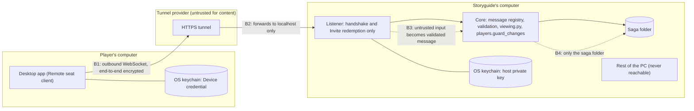

# Threat model: Remote seats

Status: draft, worked through with Hedda (STORY-2212). Design: [ADR 0009](adr/0009-remote-seats-are-outbound-only.md). Terms: see GLOSSARY.md (Remote seat, Invite, Device credential).

## 1. What we protect

Ranked by what a leak or a change would cost.

1. The saga's Secrets, and records the players don't yet know.
2. The integrity of the saga: no unauthorised edits, no lost data.
3. The storyguide's PC and the rest of their files.
4. Each player's computer and files.
5. Each player's passcode and Device credential.
6. Players' IP addresses and when they play.
7. Availability on game night.

## 2. Who we defend against

| | Actor | Note |
|---|---|---|
| A | A bad player who holds a real seat | Can send any message the protocol allows |
| B | An outsider who finds the public address | Reaches only the handshake and redemption |
| C | Someone who steals an Invite or Device credential | |
| D | A network eavesdropper or modifier, including the tunnel provider | |
| E | A malicious or compromised host | Attacks players |
| F | A player's own compromised computer | Cannot be fully defended from inside the app; the model says what is and isn't promised |

## 3. Parties and trust boundaries

Boundaries:

1. **B1**: the player's desktop to the tunnel provider.
2. **B2**: the tunnel provider to the host's listener. End-to-end encryption means the provider carries what it cannot read or alter.
3. **B3**: the listener to the core. Most controls live here.
4. **B4**: the core to the host's files. This is where "keep the host safe" is decided.

## 4. Decisions made while modelling

- The host's private key lives only in the OS keychain, never in the synced data folder; with no keychain, Remote seats are refused.
- "Rotate host key" invalidates every Invite and Device credential at once.
- End-to-end protection is a second TLS 1.3 session inside the WebSocket, pinned to the host certificate hash carried by the Invite. TLS gives fresh session keys, forward secrecy and replay protection; the spike in STORY-2213 confirms it is practical.
- The audit log lives in the host's data folder outside the saga file, so players never receive it. It records events and ids (who, when, which record), never passcodes, credentials or message bodies. The Storyguide sees it in the Remote seats list, and it is kept for a year.
- Repeated wrong passcodes lock only that device on that seat, with growing delays and a note to the Storyguide, so a guesser cannot lock a real player out. A Device credential is needed to reach the passcode step at all.
- Remote messages are handled in their own process that reaches the saga only through the core. No operating-system sandbox in the first version: a flaw in the core could still reach the Storyguide's user account.

## 5. Threats and controls (STRIDE per boundary)

S spoofing, T tampering, R repudiation, I information disclosure, D denial of service, E elevation of privilege.

| Boundary | | Threat | Control |
|---|---|---|---|
| B1 player to tunnel | S | A fake host (E, D) | Host public key from the Invite; handshake fails on a mismatch |
| | T, I | Eavesdrop or alter (D) | End-to-end authenticated encryption, forward secrecy |
| | D | Tunnel drops | Client reconnects; accepted, availability is last |
| B2 tunnel to listener | S | An outsider reaches the address (B) | Listener answers only the handshake and redemption |
| | T | Replay (D) | Ephemeral session keys, message counter |
| | I | Metadata: IP, timing, size | Accepted and documented; payload unreadable to the provider |
| | D | Floods (B) | Connection caps, rate limits, provider's own protection |
| B3 listener to core | S | Stolen Invite or credential (C) | Single use, 24 h, Storyguide approval; passcode as well; Device credential in keychain; revoke; idle expiry |
| | T | Malformed or oversized messages (A, B) | Registry of allowed types; type, shape and size checks; no deserialiser that runs code |
| | E | A seat asks for more than its rights (A) | Seat checked on every message; `viewing.py` and `players.guard_changes` |
| | I | Learning that a hidden record exists (A) | An unreadable record is treated as not existing; one uniform error |
| | R | "I never did that" | Audit log of invites, approvals, sign-ins, revocations and changes |
| | D | Expensive requests (A) | Per-seat rate limits and result-size caps |
| B4 core to files | E | Path traversal (A) | Records by id, never client-supplied paths |
| | T | Bulk overwrite (A) | Per-record changes only, merged per ADR 0005 |
| | I, E | Reaching other files on the PC | Separate process, saga access only through the core; residual risk stated above |
| | D | Disk fill | Size caps on records and portraits |
| Host to player | all | A malicious host (E) | Client converts and checks everything once on load, caps sizes, executes nothing, writes only to its own folder; bookmarks and local files never sent |
| Player's own computer | all | Malware (F) | Not defended from inside the app; the credential sits in the keychain and the Storyguide can revoke |

## 6. Residual risks we accept and state plainly

- The tunnel provider sees metadata (IP addresses, timing, message sizes) but not content.
- A compromised player computer (malware) is out of the app's reach.
- A compromised host PC exposes the whole saga, and a flaw in the core could reach the Storyguide's user account.
- A hostile Storyguide sees players' IP addresses.
- Availability depends on the tunnel and on the host's PC being on.
