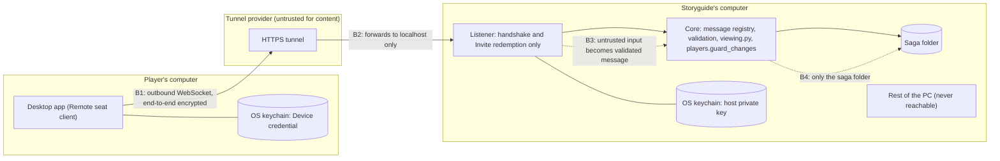

# Threat model: Remote seats

Status: draft, worked through with Hedda (STORY-2212). Design: [ADR 0009](adr/0009-remote-seats-are-outbound-only.md). Terms: see GLOSSARY.md (Remote seat, Invite, Device credential).

## 1. What we protect

Ranked by what a leak or a change would cost.

1. The saga's Secrets, and records the players don't yet know.
2. The integrity of the saga: no unauthorised edits, no lost data.
3. The storyguide's PC and the rest of their files.
4. Each player's computer and files.
5. Each player's passcode and Device credential.
6. Players' IP addresses and when they play.
7. Availability on game night.

## 2. Who we defend against

| | Actor | Note |
|---|---|---|
| A | A bad player who holds a real seat | Can send any message the protocol allows |
| B | An outsider who finds the public address | Reaches only the handshake and redemption |
| C | Someone who steals an Invite or Device credential | |
| D | A network eavesdropper or modifier, including the tunnel provider | |
| E | A malicious or compromised host | Attacks players |
| F | A player's own compromised computer | Cannot be fully defended from inside the app; the model says what is and isn't promised |

## 3. Parties and trust boundaries

Boundaries:

1. **B1**: the player's desktop to the tunnel provider.
2. **B2**: the tunnel provider to the host's listener. End-to-end encryption means the provider carries what it cannot read or alter.
3. **B3**: the listener to the core. Most controls live here.
4. **B4**: the core to the host's files. This is where "keep the host safe" is decided.

## 4. Decisions made while modelling

- The host's private key lives only in the OS keychain, never in the synced data folder; with no keychain, Remote seats are refused.
- "Rotate host key" invalidates every Invite and Device credential at once.
- End-to-end protection is a second TLS 1.3 session inside the WebSocket, pinned to the host certificate hash carried by the Invite. TLS gives fresh session keys, forward secrecy and replay protection; the spike in STORY-2213 confirmed it is practical, and `tests/test_remote_secure.py` proves it is authenticated encryption (a changed byte ends the session) at TLS 1.3.
- The inner session proves the *host* to the player and hides traffic from the tunnel provider. It does not prove the *player* to the host: anyone who finds the address completes the same handshake. The player half comes from redeeming an Invite, then the Device credential and the passcode, all sent only after the handshake (the order SSH uses).
- The pin is not a secret. Every outsider who connects sees the host's certificate and so its pin. A leaked pin is not an incident; the pin only tells a player which host to trust.
- The Invite will travel over chat apps, not in person, so the channel is the trust root and can be altered in transit. An attacker who swaps the address and pin sends the player to a fake host. Two controls: (1) the player's app shows the host's fingerprint as six short words (about 66 bits; three words, about 33, could be matched by an attacker generating keys until one fits), and the Storyguide reads them out on the voice call the group is already on; (2) the passcode is never sent, only a proof bound to the host's pin (below), so a fake host with a different pin learns nothing it can replay.
- Passcode proof. The host sends the saga's stored salt and a fresh random nonce; the client derives the scrypt digest from the passcode and that salt, and answers HMAC(digest, nonce + pin). The host holds the same digest (it is what `players.py` stores) and checks the answer. A proof made for a fake host is bound to the fake's pin and fails at the real one. Trade-offs, stated plainly: the stored digest is password-equivalent for this proof, so the saga file must be guarded (it already holds the Secrets); and a fake host can still guess a weak passcode offline from the proof it receives. A stronger scheme (a password-authenticated key exchange) has no well-reviewed Python library today. A minimum passcode length is proposed to limit the offline-guess case. Accepted by Hedda; built in STORY-2215.
- Nothing secret goes in the outer URL, path, query or headers. The tunnel provider logs the HTTP upgrade request. An Invite's code, a credential or a passcode travels only inside the private session, so a later convenience such as "put the invite code in the link" must not be added. The link may carry the host address and the pin, which are not secret.
- Behind a tunnel every connection arrives from the same local address, so per-address limits would put a flooder in one bucket with every player. Whatever starts the host behind a tunnel must turn on `trust_forwarded_address` (the header is safe to trust because the listener accepts only local connections). The listener control sets it (STORY-2219).
- A pin a player pastes is normalised (case, spaces, colons) before it is compared; text that cannot be a pin is refused with a plain message.
- The audit log lives in the host's data folder outside the saga file, so players never receive it. It records events and ids (who, when, which record), never passcodes, credentials or message bodies. The Storyguide sees it in the Remote seats list, and it is kept for a year.
- Repeated wrong passcodes lock only that device on that seat, with growing delays and a note to the Storyguide, so a guesser cannot lock a real player out. A Device credential is needed to reach the passcode step at all.
- A Device credential is made at the moment the player's app collects it after approval, handed over in that one reply and never stored in plain text on the host (only its SHA-256). If the reply is lost the player redeems a fresh Invite; there is no resend. The credential belongs to one player, so sign-in has no name to type or guess. A signed-in connection is checked against the device before every message, and a revoke also closes it at once.
- A passcode must be at least 14 characters to be set, and an older shorter one cannot be used from a Remote seat (it still works at the table and in the browser) until it is changed. A fake host can guess a weak passcode offline from one challenge; length is the defence. Which passcodes are long enough is noted in the host's data folder, not the saga (keyed to the passcode's salt, so a passcode changed any other way counts as too short until set again), and no export of the saga carries its Players: the passcode hashes are password-equivalent for the proof, so they never leave the saga file.
- Rotating the host key ends every Invite, request and Device credential, because players' apps pin the old key; players need new Invites.
- The listener runs as a process of its own, started and stopped from the Storyguide's Host for Players window. The two share the Remote seat files in the host's data folder, each change made under a lock with the file read again, so a revoke is never overwritten by an older copy; the listener cuts the connection of an ended device within a second, and checks the device before every message. Behind a tunnel the forwarded-address header is always trusted (the listener answers this computer only), and of a list header (X-Forwarded-For) only the last entry, the one the tunnel added, counts.
- A seat reads one snapshot of the saga, built by `seat_view`: the pages hide much from a player only as they are drawn, so the snapshot takes all of it out of the data itself (unknown records and every line, link, pin and member that names one, unrevealed Secrets, a threat's stages to come and its antagonist and clock, Roll Tables, hidden research targets, passcode hashes). A test draws every sheet as a player from the whole saga and from the snapshot and requires the same text; another seeds a marked word in each hiding place and requires none of them in the snapshot. A player's export is their seat view too. A revision is a hash of that seat's view, so a player learns only of changes they can see. Pictures go by name, only those the snapshot names, never by path. The snapshot travels compressed in parts after one request, checked by size and SHA-256, capped at 50 MB packed and unpacked; the player's copy is held in memory only and opened as a saga file is, and anything it can't read ends the conversation. Each side refuses another major app version.
- A seat changes the saga one record at a time (ADR 0010): the record as its Seat view had it and as the Player left it, merged three ways onto the host's full record, then what is hidden from the Player (Secrets, links and Diary lines about unknown records, a hidden research target) put back from the host's, so a change can never remove what the Player couldn't see, and Secrets a Player sends are ignored. `players.guard_changes` checks every change on the host; season plans and lab projects are only the Player's own characters'. A change is at most 2 MB packed and unpacked, sent in parts with its size and SHA-256 announced; a malformed or forbidden one gets the uniform refusal, counts as a strike and is logged, and every saved change is logged by record (kind and id, never content).
- Remote messages are handled in their own process that reaches the saga only through the core. No operating-system sandbox in the first version: a flaw in the core could still reach the Storyguide's user account.

## 5. Threats and controls (STRIDE per boundary)

S spoofing, T tampering, R repudiation, I information disclosure, D denial of service, E elevation of privilege.

| Boundary | | Threat | Control |
|---|---|---|---|
| B1 player to tunnel | S | A fake host (E, D) | Host public key from the Invite; handshake fails on a mismatch |
| | S | An Invite altered in transit, sending the player to a fake host (C, D) | Host fingerprint shown as words and read aloud on the group's voice call; if they differ the app sends nothing (no redemption, no device key, no passcode proof); passcode sent only as a proof bound to the host's pin |
| | T, I | Eavesdrop or alter (D) | End-to-end authenticated encryption, forward secrecy |
| | D | Tunnel drops | Client reconnects by itself with the passcode's derived key, held in memory for the session only; changes made meanwhile wait in memory and closing first asks; a refused device is not retried |
| B2 tunnel to listener | S | An outsider reaches the address (B) | Listener answers only the handshake and redemption |
| | T | Replay (D) | Ephemeral session keys, message counter |
| | I | Metadata: IP, timing, size | Accepted and documented; payload unreadable to the provider |
| | D | Floods (B) | Connection caps, rate limits, provider's own protection |
| B3 listener to core | S | Stolen Invite or credential (C) | Single use, 24 h, Storyguide approval; passcode as well; Device credential in keychain; revoke; idle expiry |
| | T | Malformed or oversized messages (A, B) | Registry of allowed types; type, shape and size checks; no deserialiser that runs code; a change's records checked field by field against the app's own record types, strictly (unknown keys and older shapes refused), the field named in the log (`shapes.py`, ADR 0012) |
| | E | A seat asks for more than its rights (A) | Seat checked on every message; `viewing.py` and `players.guard_changes` |
| | I | Learning that a hidden record exists (A) | An unreadable record is treated as not existing; one uniform error |
| | R | "I never did that" | Audit log of invites, approvals, sign-ins, revocations and changes |
| | D | Expensive requests (A) | Per-seat rate limits and result-size caps |
| B4 core to files | E | Path traversal (A) | Records by id, never client-supplied paths |
| | T | Bulk overwrite (A) | Per-record changes only, merged per ADR 0005 |
| | I, E | Reaching other files on the PC | Separate process, saga access only through the core; residual risk stated above |
| | D | Disk fill | Size caps on records and portraits |
| Host to player | all | A malicious host (E) | Client converts and checks everything once on load (the snapshot shape-checked strictly, field by field, ADR 0012), caps sizes, executes nothing; a Joined game's saga and pictures stay in memory, and only the game's address, pinned fingerprint and name are written (settings) and its Device credential (keychain); bookmarks and local files never sent |
| Player's own computer | all | Malware (F) | Not defended from inside the app; the credential sits in the keychain and the Storyguide can revoke |

## 6. Alternative transport considered: WebRTC (not now)

A peer-to-peer data channel (for example `aiortc`) would drop the tunnel. It is not used in the first version because it gives every player the host's IP address (the very actor A we model first), still needs a rendezvous step, fails behind carrier-grade NAT without a relay, is heavy to package, and opens inbound UDP on the host. If it is added later it enters at boundaries B1 and B2 and must be threat-modelled again; B3 and B4 do not change.

## 7. Residual risks we accept and state plainly

- The tunnel provider sees metadata (IP addresses, timing, message sizes) but not content.
- A player who skips the voice check and receives an altered Invite connects to a fake host; the passcode proof limits the harm to an offline guess at a weak passcode, but what the fake host then shows the player is the fake's.
- A compromised player computer (malware) is out of the app's reach.
- A compromised host PC exposes the whole saga, and a flaw in the core could reach the Storyguide's user account.
- A hostile Storyguide sees players' IP addresses.
- Availability depends on the tunnel and on the host's PC being on.
